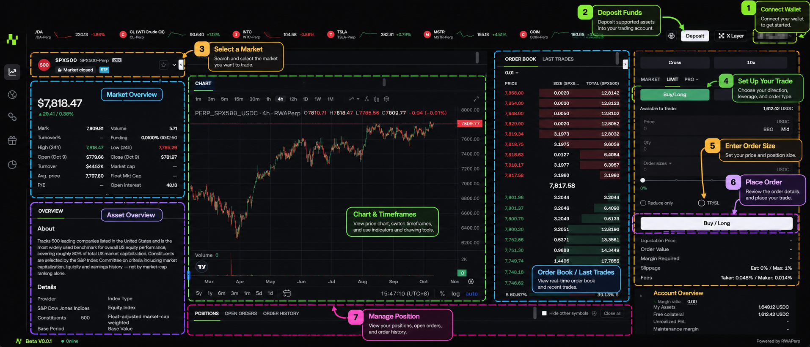

# Start Trading

<figure><figcaption></figcaption></figure>

Start your first trade on RWAPerp

After completing your deposit, you can start trading on any market supported by RWAPerp.

RWAPerp provides perpetual contract trading for various markets including Crypto, Stocks, Indices, and Commodities.

#### Step 1: Enter Trade

Access the RWAPerp trading page.

#### Step 2: Select a Trading Pair

Click on the trading pair name to select the market you wish to trade.

For example:

**NVDA-USDC**

**S\&P 500-USDC**

**GOLD-USDC**

After selecting a market, you can view:

Current Price

Price Chart

Order Book

Position

Order Panel

#### Step 3: Choose Long or Short

Determine your desired trading direction.

**Long**

If you believe the asset price will rise:

Select:

Long / Buy

**Short**

If you believe the asset price will fall:

Select:

Short / Sell

#### Step 4: Select Order Type

Choose your preferred order method.

For example:

**Market**

Open a position at the current available market price.

**Limit**

Set a target execution price; the order will trigger when the market meets those conditions.

#### Step 5: Enter Transaction Amount

Enter the size of the position you want to establish.

For example:

Margin: 100 USDC

#### Step 6: Set Leverage

Select your preferred:

Leverage

For example:

**1x/5x/10x**

⚠️ Risk Warning: Leverage can amplify both profits and losses. Higher leverage typically brings the Liquidation Price closer to your entry price.

#### Step 7: Confirm Order

Before submitting, please confirm:

Trading Pair

Long / Short

Order Type

Position Size

Estimated Entry Price

Once verified, click:

**Confirm**

#### Step 8: View Positions

After the order is filled, you can go to:

Positions

To view your current positions.

Key information includes:

Position Size

Entry Price

Mark Price

Leverage

PnL

Liquidation Price

#### Step 9: Close Position

When you want to end a trade, select the following in Positions:

Close (Market Close)

After closing the position:

Your PnL will be settled into your RWAPerp Trading Balance.

⚠️ Risk Warning: During high market volatility, the actual execution price of a Market Order may differ from the price displayed on the page.

 
